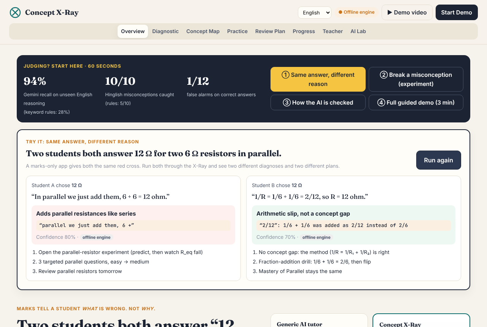
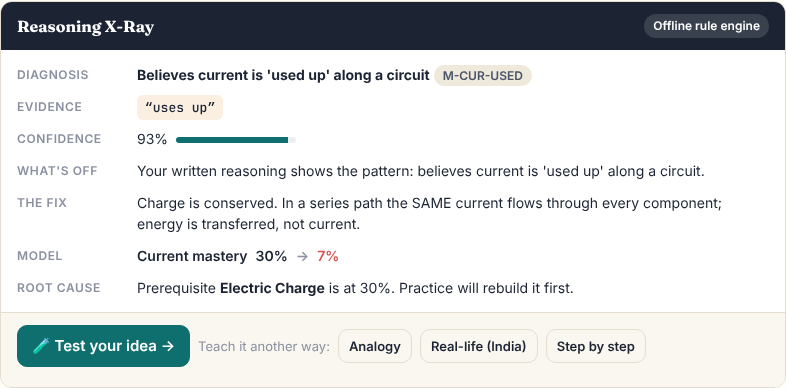
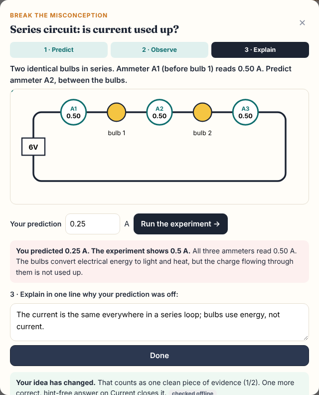
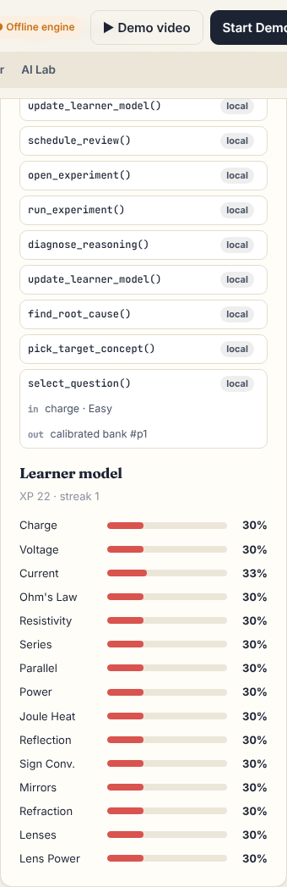
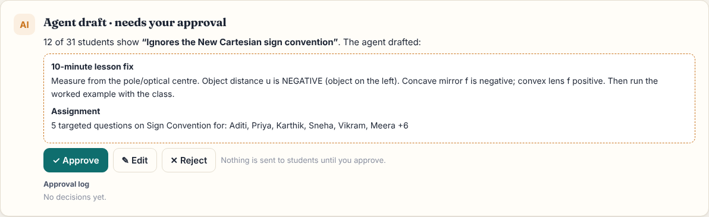

# Concept X-Ray

**Marks tell a student *what* is wrong. Concept X-Ray tells them *why*, then breaks the wrong idea with an experiment.**

**Live:** https://concept-xray.vercel.app (Gemini on) · **Demo video:** `demo/concept-xray-demo.mp4` (3 min, captioned) · In the app: **Start Demo** for a captioned 17-step guided tour.

An adaptive exam-prep tutor for CBSE Class 10 Physics (Electricity + Light).



| Reasoning X-Ray | Break the misconception |
|---|---|
|  |  |
| **Agent tool calls** | **Teacher approves the agent's draft** |
|  |  |

## Why it's an agent, not a chatbot
- **It acts on a model of the student, not on the last message.** It keeps BKT mastery for 15 concepts, misconception states, and SM-2 schedules.
- **It plans.** It traces a weak concept to its root-cause prerequisite, then picks the concept, difficulty and question.
- **It checks itself.** Each diagnosis quotes evidence; generated questions are re-solved by an independent call; accuracy is measured on held-out data.
- **It runs on its own.** One click runs the class agent: scan every learner model → cluster misconceptions → find at-risk students → find the most common root gap → draft fixes → refresh review queues → write a morning briefing.
- **A human approves anything that affects a class.** The teacher approves, edits or rejects every remedial draft, and decisions are logged.
- **It works without the AI.** Every AI call has a deterministic offline fallback, and `?demo=1` forces it.

## Why it's different

| | Marks-only apps | Generic AI tutor | **Concept X-Ray** |
|---|---|---|---|
| Two students give the same wrong answer | Same red cross | Same explanation | **Different diagnosis per student, from their reasoning** (try "Same answer, different reason" on Home) |
| Fixing a wrong belief | Shows the right answer | Explains again | **Predict → Observe → Explain experiment.** The student sees their own prediction fail, and their explanation is re-diagnosed. |
| Didn't understand the explanation | — | Repeats it | **Teach it another way**: analogy, Indian real-life example, or step by step, in English, Hinglish or हिंदी |
| What the student knows | Score | Chat history | **Bayesian Knowledge Tracing over a 15-concept prerequisite graph with root-cause tracing** |
| Is the AI right? | — | Unmeasured | **Measured on unseen wording: Gemini 94% English / 100% Hinglish recall with 1/12 false alarms, vs 28% / 50% for rules.** Generated questions are verified by a second model call. |
| Teacher | Marks sheet | — | **Agent drafts the remedial lesson; the teacher approves, edits or rejects it**, with an approval log |

## Problem-statement coverage

| Required | How Concept X-Ray does it |
|---|---|
| Diagnostic test | 10 questions across both chapters. Each one collects the option, one line of reasoning and the student's confidence |
| Concept graph for one syllabus | 15 concepts with 14 prerequisite edges (Class 10 Electricity + Light), drawn live with mastery rings |
| Learner model updated after every answer | Bayesian Knowledge Tracing per concept, with guess and slip rates that depend on difficulty |
| Question generation for weak concepts, with difficulty calibration | Targets the weakest concept, or its weaker prerequisite (root-cause tracing). Difficulty is set from mastery to aim for about 70% success. Gemini generates new questions that include a distractor for the student's active misconception |
| Misconception detection from reasoning | Gemini 2.5 Flash classifies typed reasoning or a notebook photo into a 12-item misconception list, quoting the evidence. An offline rule engine using the same list is the fallback |
| Spaced repetition | SM-2 with confidence-weighted quality (being confidently wrong resets a card hardest) and a 15-day timeline |
| Teacher dashboard | Class heatmap, shared misconceptions, students needing attention, a suggested lesson fix, one-click remedial assignment, CSV export |

Beyond the brief:
- **Break the Misconception lab**: 4 interactive experiments (series current, parallel resistors, wire length, lens power). The student predicts, observes, then explains, and the explanation is re-diagnosed as evidence toward *Fixed ✅*.
- **Same answer, different reason**: a live opener on the Home page
- **Teach it another way** (`/api/reteach`) in 3 approaches × 3 languages, with a built-in fallback
- **The agent as tool calls**: `diagnose_reasoning → update_learner_model → schedule_review → find_root_cause → pick_target_concept → generate/verify_question`, each with input, output, time and engine
- **Teacher approval**: Approve / Edit / Reject the agent's draft, with a decision log
- **Honest uncertainty**: each concept shows how sure the tutor is about the student (no evidence / low / medium / high), so a 30% starting guess is never presented as a fact
- **WhatsApp report** to a parent or teacher, in the chosen language
- **Agent decision trace**: why this question was chosen, step by step
- **Closed loop**: a misconception is marked *Fixed ✅* after two correct, hint-free answers in a row
- **Hint ladder** (nudge → trap warning → method). Each hint lowers the mastery credit, so answers are earned.
- **Proof of Learning report**: before vs now, learning gain, misconception evidence, downloadable for the teacher
- **AI Lab**: runs the held-out answers through live Gemini in the browser, plus a list of the guardrails
- **Verified question generation**: a second, independent Gemini call solves each generated question, and it's discarded if the answers disagree
- **Recall-today %** (FSRS-style retrievability) in the review plan
- **Photo** of handwritten working, **voice** input (en-IN), Hinglish-tolerant reasoning

## Ideas we built on
We studied well-known open-source tutoring projects and implemented their ideas in our own code. No code was copied.

| Project | Idea |
|---|---|
| CAHLR/OATutor, Li-Evan/BloomTutor | Hint ladders, mastery per skill |
| CAHLR/pyBKT, pykt-toolkit | Bayesian Knowledge Tracing |
| open-spaced-repetition/fsrs4anki | Recall probability |
| Eedi "Mining Misconceptions" (Kaggle) | Answer options mapped to misconceptions |
| Cognitive-tutor research (model tracing) | Checking the AI's output rather than trusting it |

## Architecture

```
Browser (vanilla JS, no build)               Serverless (/api, Vercel)
 ├─ data.js    syllabus graph, taxonomy, bank  ├─ analyze.js  → Gemini: reasoning/photo → misconception JSON
 ├─ engine.js  BKT · SM-2 · root cause ·       ├─ generate.js → Gemini: targeted MCQ with a misconception trap
 │             selection · local fallback      └─ health.js   → reports whether AI is live
 ├─ app.js     6 views + teacher analytics     The API key lives only on the server.
 └─ tour.js    guided demo with captions       Every AI call has a timeout and falls back to the local engine.
```

## Evaluation (honest numbers)

`npm run eval` scores the **offline** engine on hand-labelled student responses:

| Set | n | Full engine accuracy | Recall from reasoning text alone |
|---|---|---|---|
| Development (rules written against it) | 40 | 100% | 86% |
| Held-out (new phrasings, rules not tuned on it) | 20 | 100% | **28%** |
| **Gemini, same held-out set, text only** (live, 21 Nov 2026) | 18 with a misconception | — | **78% (14/18)** |
| **Gemini, 40-item run (English held-out)** (live) | 18 | — | **94% (17/18)** |
| **Gemini, Hinglish** (live) | 10 | — | **100% (10/10)** |
| **Gemini, false alarms on correct or slip reasoning** (live) | 12 | — | **1/12** |
| Held-out v2, Hinglish (offline rules) | 10 | — | 50% (5/10) |
| Held-out v2, *correct* reasoning (offline rules): false alarms | 10 | — | 1/10 |

The v2 set (`eval/heldout2.json`) can be run live through Gemini from the AI Lab page, which reports English recall, Hinglish recall and the false-alarm rate. Gemini's v2 numbers above come from a live AI Lab run on the deployed site. `?demo=1` forces the offline engine for a guaranteed-stable demo, and the badge says "Demo mode (offline)".

The full engine scores 100% partly because each wrong option is pre-mapped to a misconception. On reasoning text alone, keyword rules don't generalise to new wording (28%). **That is why the live product uses Gemini** for reasoning, and why the rule engine is only an offline fallback. Gemini recalls **78%** of held-out misconceptions from text alone, nearly 3× the rules. Its 4 misses: three phrasings where it returned no misconception, and one it labelled as a sign-convention error instead of a mirror/lens mix-up. We did not tune the prompt on this set. The same held-out set can be re-run through live Gemini from the app's **AI Lab** page. In a spot check on the deployed site, Gemini correctly diagnosed "after passing through a bulb the current reduces" as *current is used up*, with 95% confidence and quoted evidence. That phrasing is one the rules miss.

## Tests
Engine unit tests (23 checks on BKT, SM-2, recall, the misconception engine, the lifecycle, hint credit and data integrity) and a 32-check end-to-end browser test of every flow at desktop and phone width:

```bash
npm test
npm run dev &  # then:
node tests/e2e.js
```

## Run it

Run the dev server (opens on http://localhost:3000):

```bash
npm run dev
```

To use Gemini, set the key first:

```bash
GEMINI_API_KEY=... npm run dev
```

To deploy, push the folder to Vercel and set `GEMINI_API_KEY` in the project's environment variables.

Re-record the demo video (needs the dev server running):

```bash
node record/record.js
```

## Guardrails
- Hints and explanations come after the attempt. It never just hands over the answer.
- Learner data stays in the browser's localStorage. No accounts are needed for minors.
- AI diagnoses always show their evidence and confidence, so a teacher can override them.
